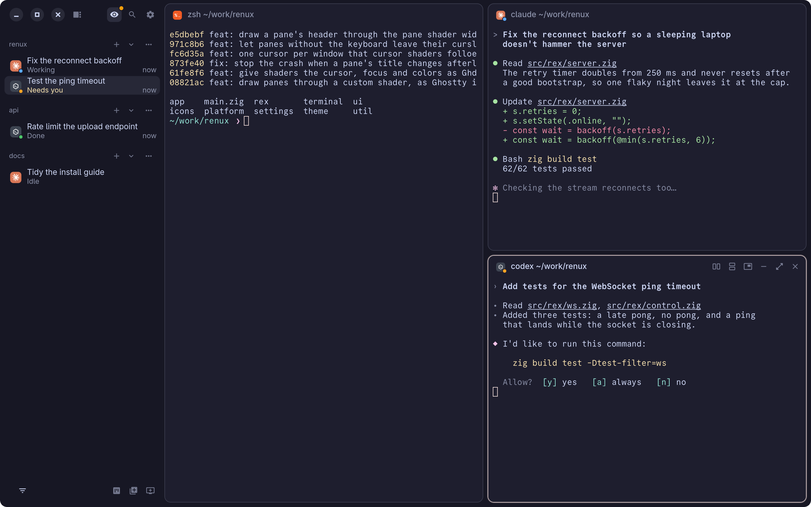
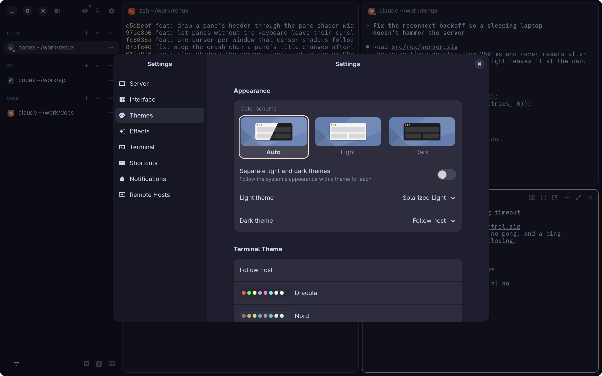

<p align="center"></p>

# Renux

A native Linux client for [Rex](https://rex.superlogical.com), written in Zig with GTK4 and
libadwaita. It shows a Rex server's sessions, windows and panes, with live terminals drawn
through libghostty-vt.


## What it does

- **Your Rex sessions, as they are.** Sessions, tabs and panes live on the Rex server, so they
  are the same here, in the Rex app and on a phone. Key bindings come from your Rex config.
- **Fast terminals.** Text is drawn with libghostty-vt, with selection, find, links, box
  drawing, and your own font and theme.
- **An eye on your agents.** Panes running coding agents show what they are doing. The agent
  board sorts them into Idle, Running, Attention and Done; the eye in the sidebar lists only
  agents, with a dot when one needs you.
- **Several servers.** Connect to more than one Rex server, on this computer or over Tailscale,
  and be told when one could be updated.
- **Made to look at.** Themes, a see-through window with the desktop's blur behind it, and
  custom GLSL shaders as in Ghostty: ten ship with Renux, from a CRT to a cursor that smears as
  it moves.

| The agent board | Only agents in the sidebar |
|---|---|
|  |  |



## Installing

There are no packages yet, so Renux is built from source. You need a Rex server to connect to;
see [Rex's installation guide](https://www.superlogical.com/rex/docs/linux/installation.md).

1. Install Zig 0.17 and the libraries, with their development files:

   | Distribution | Command |
   |---|---|
   | Fedora | `sudo dnf install gtk4-devel libadwaita-devel librsvg2-devel` |
   | Debian, Ubuntu | `sudo apt install libgtk-4-dev libadwaita-1-dev librsvg2-dev` |
   | Arch Linux | `sudo pacman -S gtk4 libadwaita librsvg` |

2. Build and install into `~/.local`, which puts the program, its desktop entry and its icon
   where your desktop looks for them:

   ```sh
   git clone --recurse-submodules <the address of this repository> renux
   cd renux
   zig build -Doptimize=ReleaseFast -p ~/.local
   ```

3. Start Renux from your applications menu, or run `renux`. With Rex installed on this
   computer, it connects to the Rex server here, and starts it if it isn't running. Otherwise
   it asks for your Rex server's address.

`renux --toggle` shows or hides the running window, for a desktop shortcut.
`renux --version` prints the version.

The program is called `renux`, and its desktop ID is `dev.renux`. Settings are kept in
`~/.config/renux`.

## Building

You need Zig 0.17, GTK 4, libadwaita and librsvg, with their development files.

```sh
git submodule update --init
zig build -Doptimize=ReleaseFast
zig build test
```

The program is `zig-out/bin/renux`. Add `-Ddev` for the development hooks: screenshots, the
test script and the frame log.

On a Mac with Homebrew, for development, point pkg-config at Homebrew first:

```sh
export PKG_CONFIG_PATH=/opt/homebrew/lib/pkgconfig:/opt/homebrew/share/pkgconfig
```

## Layout

| Path | What it holds |
|---|---|
| `src/main.zig` | Where the program starts |
| `src/app/` | The window and its actions, start-up, local server and pairing pages |
| `src/ui/` | Panes and their cards, the agent board, the activity panel, the palette and other dialogs, find, hover cards |
| `src/terminal/` | The terminal widget, the terminal model on libghostty-vt, keys, links, fonts |
| `src/rex/` | The Rex protocol: control connection, output streams, WebSocket, layout model |
| `src/settings/` | Settings, their window, shortcuts and the theme editor |
| `src/theme/` | Colors and built-in themes |
| `src/icons/` | Interface and program icons, and how they are drawn |
| `src/platform/` | Parts for one operating system only |
| `src/util/` | Small helpers: JSON, drawing, subprocesses, QR codes |
| `data/` | What is installed beside the program: desktop file, app icons, fonts, program icons, shaders |
| `scripts/` | Generators for the icon tables in `src/icons/` |
| `third_party/ghostty` | Ghostty, for its terminal library |

## License

Apache 2.0; see `LICENSE`. Bundled fonts and icons keep their own licenses, noted beside them.
