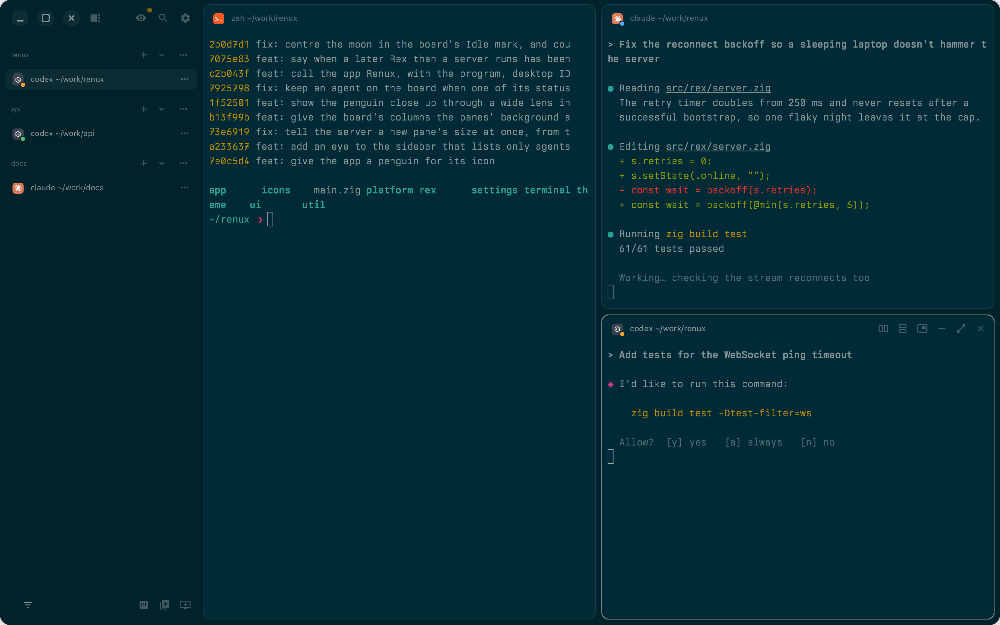
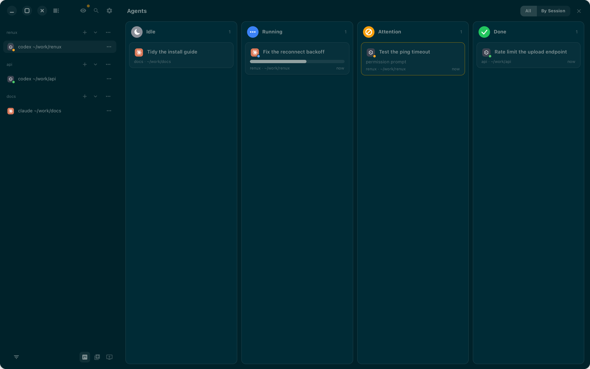
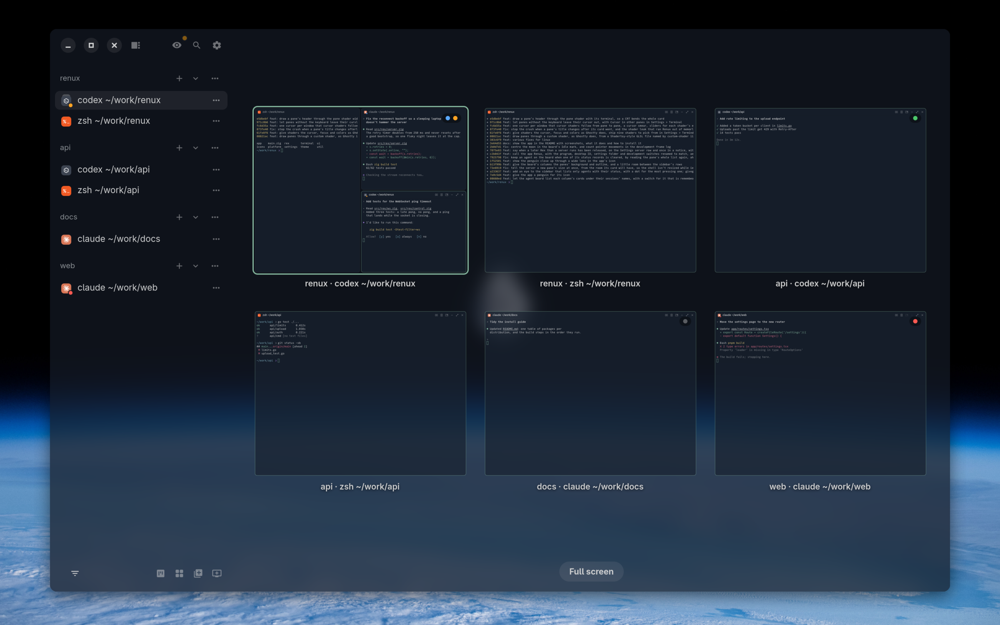
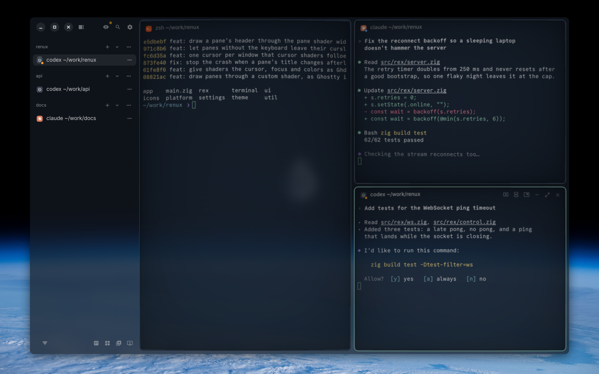
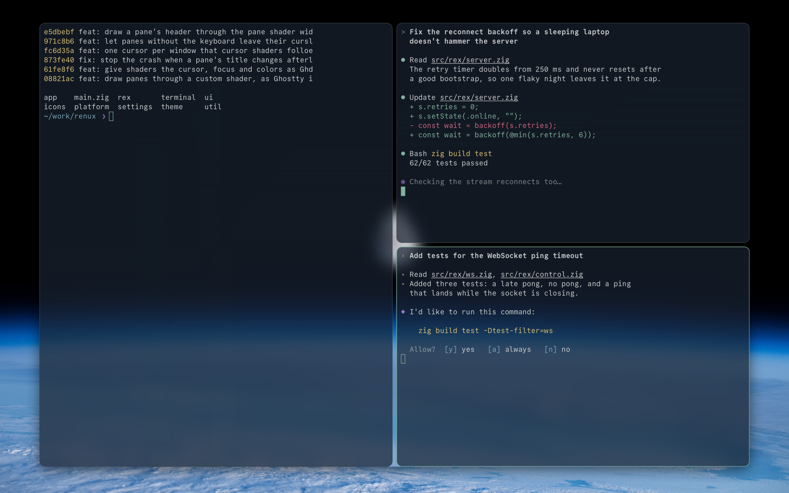

<p align="center"></p>

# Renux

A native Linux client for [Rex](https://rex.superlogical.com), written in Zig with GTK4 and
libadwaita. It shows a Rex server's sessions, windows and panes, with live terminals drawn
through libghostty-vt.

Renux is an independent project, not made by the Rex team. It is early, so expect rough edges,
and please report them as [issues](https://github.com/zenodea/renux/issues).



[](docs/screenshots/demo.mp4)

*Click for the full-size video.*

## What it does

- **Your Rex sessions, as they are.** Sessions, tabs and panes live on the Rex server, so they
  are the same here, in the Rex app and on a phone. Key bindings come from your Rex config.
  New tabs, splits and floating shells start in the source pane's current directory when
  Rex can report it, even without shell integration.
- **Fast terminals.** Text is drawn with libghostty-vt, with selection, find, links, box
  drawing, and your own font and theme.
- **Keyboard copying.** Copy mode holds the scrollback still while the program keeps running.
  Move with Vim keys, search, select characters, lines or a rectangle, and yank to the clipboard.
- **Every tab at once.** The overview zooms out from the tab you are on to a grid of all your
  tabs, each drawn as its live terminals. A dot on a tab shows what each agent in it is doing.
  Pick a tab and it zooms back in.
- **Room for your panes.** Drag the sidebar's inner edge to resize it. Renux remembers the
  width. Shortcuts fade as space runs out; the **⋯** menu at the bottom keeps their actions
  within reach. Switch **Window background** off in Settings > Effects and the window draws
  none: the panes, the sidebar and the board are cards with the desktop between them.
- **Your agents at a glance.** Panes running coding agents show what they are doing, and the
  agent board sorts them into Idle, Running, Attention and Done. In Settings > Server > Agents,
  **Keep this computer awake while an agent is working** asks your desktop to prevent suspend
  and idle sleep while any connected pane reports working. It is off by default and releases
  when work stops, the switch goes off, or Renux closes. Your desktop has the final say.
- **Files for remote panes.** Drop files, or paste copied files or a clipboard image with
  Ctrl+Shift+V. Coding-agent panes also accept attachments with Ctrl+V. Rex uploads them and
  inserts their remote paths, in order, once all have arrived. The first file's name shows at
  the cursor and fills in as they go. Local panes insert local paths. Screenshots become PNG
  files. Each file can be up to 100 MB.
- **Peek at files.** Ctrl+click a file path to see the file by it, locally or remotely: the
  lines around the one named, in syntax colors, a picture, or a PDF. In a PDF, Right/Left
  and Page Down/Page Up turn pages; the name row shows the current page and total.
  Enter opens the file in your
  editor in a new pane to the right (`nvim` by default; the Editor command setting changes
  it), and Shift+Enter in a new window. For a picture or PDF, Enter opens your desktop viewer. Hold
  Ctrl to underline a detected path; Esc closes the peek. For paths with ambiguous spacing,
  select the path and choose **Preview Selected Path** from the right-click menu, which
  offers **Open With…** for other formats. **Quick Look** in the command palette lists the
  files and links on the focused pane's screen; choose a file to peek at it. Web links open
  your browser. Requires Rex API 13; files up to 16 MiB.
- **Download from a remote pane.** Ctrl+click a folder's path to see what is in it; Enter
  copies the whole folder to this computer's Downloads folder. In a file's peek, Ctrl+D (or
  the **Download** button) does the same for the file, whatever its size. A message at the
  foot of the window shows how far it has got, with **Cancel**, and then **Show** to find it
  in your files app. Nothing is written over: a name that is taken gets a number, as in
  `notes (2).md`. Links to folders and files that can't be read are left out and counted.
  For a folder on this computer, Enter opens it in your files app.
- **Remote development links.** Ctrl+click an HTTP(S) localhost link with a port in a remote
  pane: Renux forwards it to a free port on this computer and opens the same path and query in
  your browser. Repeated clicks reuse the forward. **Forward Port…** in Commands discovers
  the focused pane's listening ports, accepts a port or `host:port`, and shows the forwards
  this window carries, with a close button for each. Requires a Rex CLI/server with port
  forwarding; port discovery needs Rex API 15. Local panes keep opening links directly.
- **Several servers.** Connect to more than one Rex server, on this computer, over Tailscale,
  or through SSH (`user@box` or `ssh://user@box:2222`), and be told when one could be updated.
  SSH uses your system's keys, config and agent, with one connection shared by terminals and
  file transfers. Trust the host and unlock your key in a terminal first; Renux does not answer
  SSH questions yet. Remote hosts can answer to this computer's keys and keep their own colors.
  See [SSH hosts](docs/ssh-hosts.md).
- **Made to look at.** Themes, a see-through window with the desktop's blur behind it, and
  custom GLSL shaders as in Ghostty: ten ship with Renux, from a CRT to a cursor that smears as
  it moves.

| Agent Board | Overview |
|---|---|
|  |  |

| Shaders | No window background |
|---|---|
|  |  |

## Installing

There are no packages yet, so Renux is built from source. You need a Rex server to connect to.

1. Install Zig 0.17 and the libraries, with their development files:

   | Distribution | Command |
   |---|---|
   | Fedora | `sudo dnf install gtk4-devel libadwaita-devel librsvg2-devel poppler-glib-devel` |
   | Debian, Ubuntu | `sudo apt install libgtk-4-dev libadwaita-1-dev librsvg2-dev libpoppler-glib-dev` |
   | Arch Linux | `sudo pacman -S gtk4 libadwaita librsvg poppler-glib` |

2. Build and install into `~/.local`, which puts the program, its desktop entry and its icon
   where your desktop looks for them:

   ```sh
   git clone --recurse-submodules https://github.com/zenodea/renux
   cd renux
   zig build -Doptimize=ReleaseFast -p ~/.local
   ```

3. Start Renux from your applications menu, or run `renux`. With Rex installed on this
   computer, it connects to the Rex server here, and starts it if it isn't running. Otherwise
   it asks for your Rex server's address.

`renux --toggle` shows or hides the running window, for a desktop shortcut.
Settings are kept in `~/.config/renux`.

## Keys

Key bindings come from your Rex config, so the keys you know work here. Renux adds an action
of its own to bind there:

```lua
rex.bind("ctrl+a>shift+o", "client.overview.toggle") -- every tab at once
```

The overview and the agent board are off until you switch them on in Settings, under
Developer. The overview is in the command palette too, and has a button at the foot of the
sidebar.
In the overview, the arrow keys or `h` `j` `k` `l` move between tabs, Enter goes to one and
Escape goes back. `x` closes the tab the ring is on, `c` opens a new tab in its session and
goes to it, and `s` groups the tabs by session.

The command palette also offers **Mute or unmute tab**, **Switch host**, **Remove host…**,
and **Refresh sessions**, plus clipboard and pane-management commands. Muting silences a
tab's notifications, activity sounds and launcher badge for this run, without hiding its
activity. Removing a host asks first and leaves its sessions running. See
[the action audit](docs/action-coverage.md) for coverage and platform differences.

**Close Session…** asks for confirmation before ending every program in the current session.

### Copy mode

**Ctrl+Shift+Space** enters copy mode in the focused pane (**Shift+Command+C** on macOS).
The mode chip shows the cursor's row and column, selection kind, and any search being typed.
The entry shortcut can be changed in Settings > Shortcuts, or bound in your Rex config:

```lua
rex.bind("ctrl+a>[", "pane.copy_mode.enter")
```

- Move with `h j k l` or the arrows; `w b e` move by word, `W B E` by whitespace-separated word.
  `0 ^ $` and Home/End move within the logical line; `H M L` within the visible screen.
- `Ctrl+U/D` move half a screen, `Ctrl+B/F` or Page Up/Down a full screen. `g/G` jump to the
  top/bottom of the scrollback; `{` and `}` move between paragraphs. Type a count first to
  repeat a motion (`12k`), or choose a line (`12G`).
- `v` selects characters, `V` whole lines, `Ctrl+V` a rectangle; the same key ends that kind
  of selection. `o` swaps its ends.
- `/` or `?` opens a forward/backward literal search; Enter searches, `n/N` repeat/reverse it.
  `f F t T` find a character in the logical line; `;` and `,` repeat/reverse that find.
- `y` or Enter copies the selection and leaves. `D` copies to the end of the logical line.
  Escape or `q` leaves without copying and restores the original viewport.

Wide characters are one cursor stop, wrapped rows remain one logical line, and copying uses
exactly the same text formatter as mouse selection. [Copy-mode details and actions](docs/copy-mode.md).

A remote host answers to its own Rex config. For the same keys everywhere, turn on
Settings > Remote Hosts > Use this computer's keys on remote hosts.

Ctrl+click remote links to `localhost`, `127.0.0.1`, `[::1]` or `0.0.0.0` with an explicit
port to forward and open them. Bind `client.host.forward_port` in your Rex config, or choose
**Forward Port…** in Commands, to discover ports, enter a target, or close a forward.
Forwards listen only on `127.0.0.1` and close when this Renux window quits or the host is removed.
See [port forwarding](docs/port-forwarding.md) for requirements and limitations.

## Building

You need Zig 0.17, GTK 4, libadwaita, librsvg and poppler-glib, with their development files.

```sh
git submodule update --init
zig build -Doptimize=ReleaseFast
zig build test
```

The program is `zig-out/bin/renux`. Add `-Ddev` for the development hooks: screenshots, the
test script and the frame log.

`zig build test-upload` checks file uploads against a disposable local Rex server. It needs
`rex` (API revision 11 or newer) and Python 3; it does not use your running sessions.
`zig build test-clipboard` also exercises the GTK paste handler on a private display, including
images and Ctrl+V; it additionally needs `gtk4-broadwayd` and never changes your clipboard.
`zig build test-preview` uses the same isolated setup to check downloads and preview dialogs.
`zig build test-fetch` downloads a folder and a large file from it and compares every byte.
`zig build test-forward` checks TCP forwarding, URL rewriting, reuse and cleanup against a
private Rex server and HTTP target. It needs `rex`, `curl` and Python 3, but no display.

## License

Apache 2.0; see `LICENSE`. Bundled fonts and icons keep their own licenses, noted beside them.
