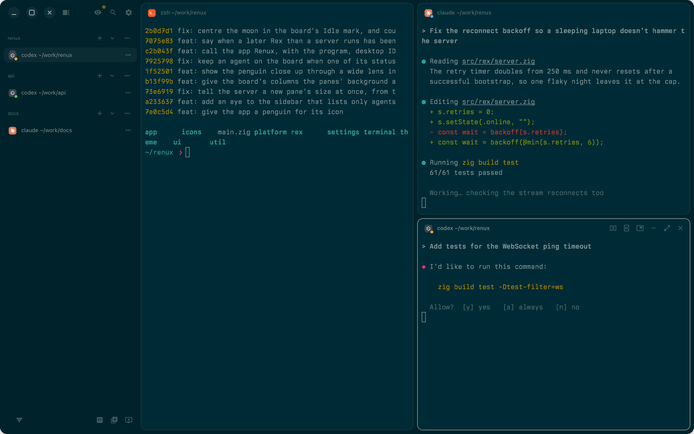
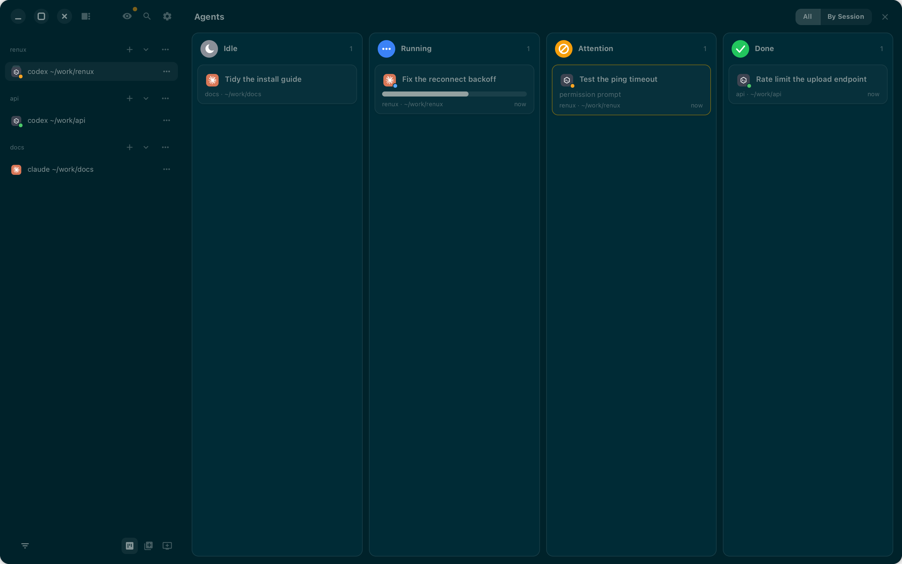
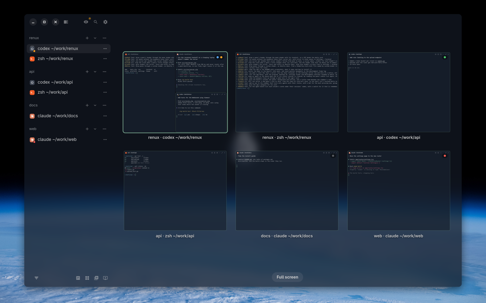
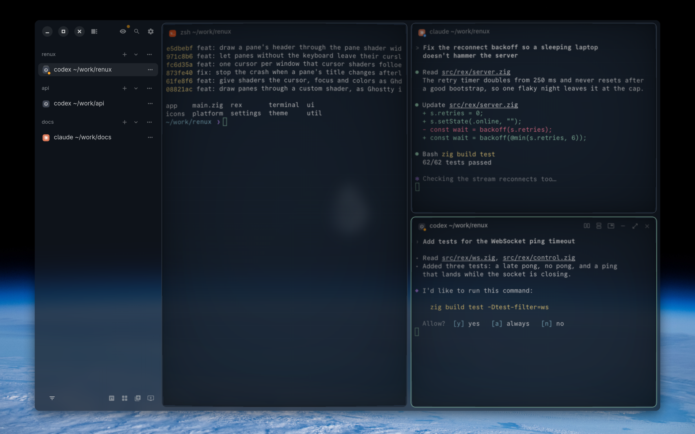
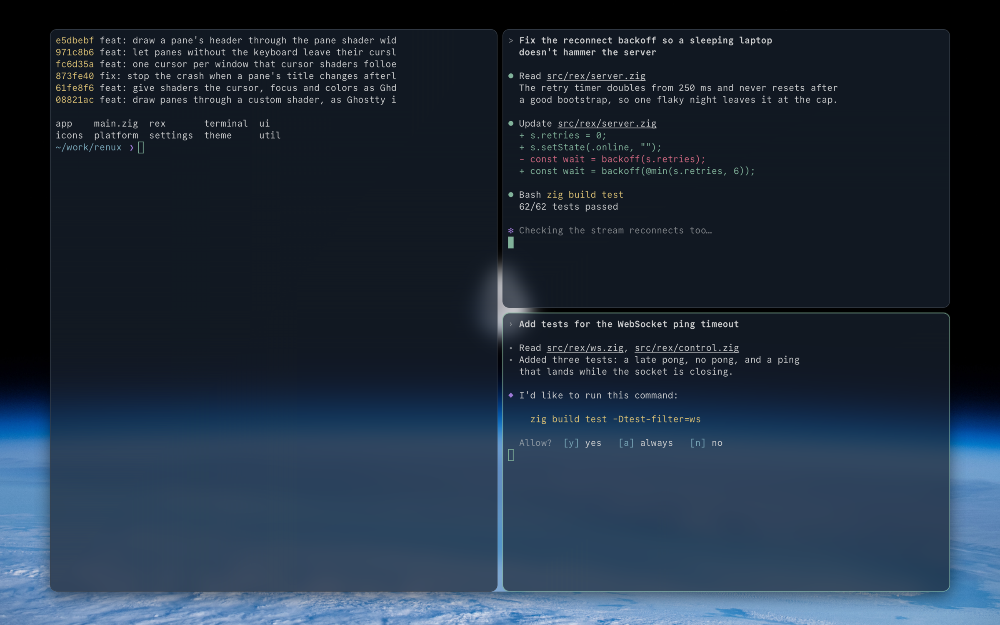

<p align="center"></p>

# Renux

A native Linux client for [Rex](https://rex.superlogical.com), written in Zig with GTK4 and
libadwaita. It shows a Rex server's sessions, windows and panes, with live terminals drawn
through libghostty-vt.

Renux is an independent project, not made by the Rex team. It is early, so expect rough edges,
and please report them as [issues](https://github.com/zenodea/renux/issues).



## What it does

- **Your Rex sessions, as they are.** Sessions, tabs and panes live on the Rex server, so they
  are the same here, in the Rex app and on a phone. Key bindings come from your Rex config.
- **Fast terminals.** Text is drawn with libghostty-vt, with selection, find, links, box
  drawing, and your own font and theme.
- **Every tab at once.** The overview zooms out from the tab you are on to a grid of all your
  tabs, each drawn as its live terminals. A dot on a tab shows what each agent in it is doing.
  Pick a tab and it zooms back in.
- **Only the terminals.** Full screen mode hides the sidebar, the title rows and the window's
  own background, so the panes fill the window.
- **Your agents at a glance.** Panes running coding agents show what they are doing, and the
  agent board sorts them into Idle, Running, Attention and Done.
- **Several servers.** Connect to more than one Rex server, on this computer or over Tailscale,
  and be told when one could be updated. Remote hosts can answer to this computer's keys and
  keep their own colors.
- **Made to look at.** Themes, a see-through window with the desktop's blur behind it, and
  custom GLSL shaders as in Ghostty: ten ship with Renux, from a CRT to a cursor that smears as
  it moves.

| Agent Board | Overview |
|---|---|
|  |  |

| Shaders | Full screen mode |
|---|---|
|  |  |

## Installing

There are no packages yet, so Renux is built from source. You need a Rex server to connect to.

1. Install Zig 0.17 and the libraries, with their development files:

   | Distribution | Command |
   |---|---|
   | Fedora | `sudo dnf install gtk4-devel libadwaita-devel librsvg2-devel` |
   | Debian, Ubuntu | `sudo apt install libgtk-4-dev libadwaita-1-dev librsvg2-dev` |
   | Arch Linux | `sudo pacman -S gtk4 libadwaita librsvg` |

2. Build and install into `~/.local`, which puts the program, its desktop entry and its icon
   where your desktop looks for them:

   ```sh
   git clone --recurse-submodules https://github.com/zenodea/renux
   cd renux
   zig build -Doptimize=ReleaseFast -p ~/.local
   ```

3. Start Renux from your applications menu, or run `renux`. With Rex installed on this
   computer, it connects to the Rex server here, and starts it if it isn't running. Otherwise
   it asks for your Rex server's address.

`renux --toggle` shows or hides the running window, for a desktop shortcut.
Settings are kept in `~/.config/renux`.

## Keys

Key bindings come from your Rex config, so the keys you know work here. Renux adds two actions
of its own to bind there:

```lua
rex.bind("ctrl+a>shift+o", "client.overview.toggle")   -- every tab at once
rex.bind("ctrl+a>shift+f", "client.fullscreen.toggle") -- only the terminals
```

Both are in the command palette too, and the overview has a button at the foot of the sidebar.
In the overview, the arrow keys or `h` `j` `k` `l` move between tabs, Enter goes to one and
Escape goes back. `x` closes the tab the ring is on, `c` opens a new tab in its session and
goes to it, and `s` groups the tabs by session.

A remote host answers to its own Rex config. For the same keys everywhere, turn on
Settings > Remote Hosts > Use this computer's keys on remote hosts.

## Building

You need Zig 0.17, GTK 4, libadwaita and librsvg, with their development files.

```sh
git submodule update --init
zig build -Doptimize=ReleaseFast
zig build test
```

The program is `zig-out/bin/renux`. Add `-Ddev` for the development hooks: screenshots, the
test script and the frame log.

## License

Apache 2.0; see `LICENSE`. Bundled fonts and icons keep their own licenses, noted beside them.
